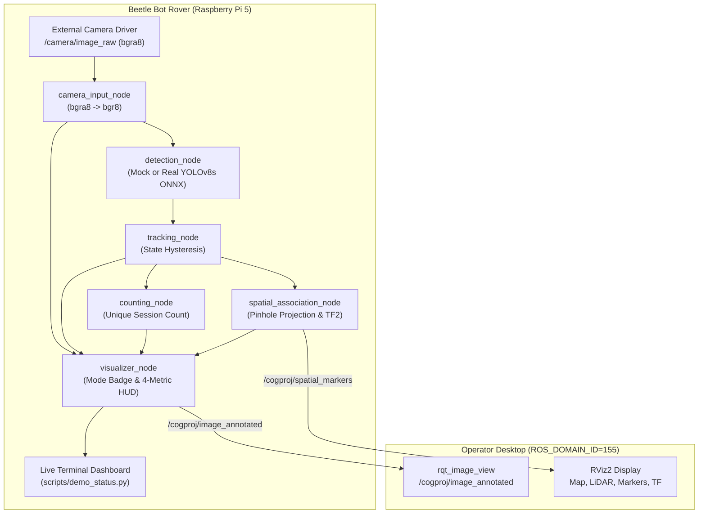

# CogProj Demonstration Showcase & Operator Startup Guide

**Project:** CogProj — AI-Based Ore Detection and Counting Rover  
**Target Platform:** Veerobot Beetle Bot, Raspberry Pi 5 ARM64 (BCM2712 @ 2.4 GHz), Ubuntu 24.04.3 LTS, ROS 2 Jazzy  
**Workspace:** `/home/veerobot/CogProj`  
**Network Domain:** `ROS_DOMAIN_ID=155` | `RMW_IMPLEMENTATION=rmw_fastrtps_cpp`  
**Phase:** 5K — Demo-Ready Visual Integration  

---

## 1. Overview & Visual Architecture

CogProj provides a coherent, robust demonstration experience connecting live camera ingestion, deep-learning perception, multi-object temporal tracking, unique session counting, planar LiDAR fusion, and SLAM mapping.

The system is engineered for dual-environment operation:
- **Embedded Rover (Raspberry Pi 5):** Headless ROS 2 computation executing the perception graph, feature tracking, zero-fabrication spatial projection, and live text monitoring.
- **Operator Workstation (Ubuntu Desktop / Laptop):** High-refresh visualization over the local ROS 2 network (`ROS_DOMAIN_ID=155`) via `rqt_image_view` and `rviz2`.



---

## 2. Pre-Flight Diagnostic Verification

Always run the automated pre-flight checker before starting a demonstration:

```bash
source /opt/ros/jazzy/setup.bash
source /home/veerobot/CogProj/install/setup.bash
python3 /home/veerobot/CogProj/scripts/preflight_check.py --mode mock
```

*(Or via ROS 2 CLI: `ros2 run cogproj_bringup preflight_check --mode mock`)*

The pre-flight checker inspects the environment and reports actionable diagnostic alerts:
- **`[CAMERA UNAVAILABLE]`**: `/camera/image_raw` has 0 active publishers.
- **`[CAMERA NOT CALIBRATED]`**: Camera matrix $K$ focal lengths are zero. 3D coordinates remain zeroed (`0,0,0`) under the zero-fabrication safety contract.
- **`[LIDAR ASSOCIATION UNAVAILABLE]`**: `/scan` is not publishing. Spatial projection waits for LiDAR.
- **`[SLAM MAP UNAVAILABLE]`**: `/map` is offline. Mapping requires starting SLAM Toolbox.

---

## 3. Demonstration Workflow & Two Explicit Modes

CogProj features two mutually exclusive operational modes. **Mock detections are never conflated with real machine-learning predictions.**

### MODE A: Mock Demonstration (Synthetic Test Objects)

Mode A exercises the entire perception, tracking, counting, and visualization pipeline using deterministic synthetic targets. It uses the physical camera stream (or test canvas) as the image background.

Every annotated frame prominently displays an **orange `[MOCK / SIMULATED]` badge** in the upper banner.

#### Command to Launch:
```bash
source /opt/ros/jazzy/setup.bash
source /home/veerobot/CogProj/install/setup.bash
ros2 launch cogproj_bringup demo_showcase.launch.py detector_mode:=mock
```

*(Optional simulated map for RViz layout demonstration: add `publish_simulated_demo_map:=true`)*

---

### MODE B: Real Detector Demonstration (Trained YOLOv8s ONNX)

Mode B loads the trained YOLOv8s ONNX model (`/home/veerobot/CogProj/Rover (2)/best.onnx`, 832x832 input) using the OpenCV DNN adapter (`models/ore_yolo/adapter.py`).

Detections represent genuine neural network inferences on physical ore specimens (`resource`, `host_rock`). Frames display a **cyan `[REAL: YOLOv8s ONNX]` badge**. When zero ores are in view, the model outputs zero detections honestly without fabricating targets.

#### Command to Launch:
```bash
source /opt/ros/jazzy/setup.bash
source /home/veerobot/CogProj/install/setup.bash
ros2 launch cogproj_bringup demo_showcase.launch.py detector_mode:=real
```

---

## 4. Visual Interfaces Across Machines

### Interface 1: Operator Desktop Annotated Video (`rqt_image_view`)
On your desktop workstation connected to the same WiFi network:
```bash
export ROS_DOMAIN_ID=155
export RMW_IMPLEMENTATION=rmw_fastrtps_cpp
ros2 run rqt_image_view rqt_image_view /cogproj/image_annotated
```
*Displays:* High-resolution 2D camera view, colored track boxes, track IDs (`#ID`), confidence scores, tracking states (`[CONF]`, `[TENT]`, `[LOST]`), mode badges (`[MOCK / SIMULATED]`), and the dual-line HUD.

### Interface 2: Operator Desktop 3D RViz Visualization (`rviz2`)
On your desktop workstation:
```bash
export ROS_DOMAIN_ID=155
export RMW_IMPLEMENTATION=rmw_fastrtps_cpp
rviz2 -d /home/veerobot/CogProj/src/cogproj_bringup/rviz/cogproj_slam_ore.rviz
```
*Displays:*
- **OccupancyGrid:** Real SLAM map on `/map` (or `/cogproj/demo_simulated_map`).
- **LaserScan:** 2D planar range scan on `/scan`.
- **TF Tree:** Robot kinematic frames (`base_footprint`, `base_link`, `lidar_link`, `camera_optical_link`, `odom`, `map`).
- **Spatial Markers:** Colored 3D spheres and floating text tags on `/cogproj/spatial_markers` (Cyan for `resource`, Amber for `host_rock`).
- **Camera Image:** Embedded live feed on `/cogproj/image_annotated`.

*(Note: For demonstration runs without SLAM mapping, use `cogproj_demo_view.rviz` which sets Fixed Frame to `base_footprint` to avoid missing map frame warnings).*

### Interface 3: Headless SSH Terminal Dashboard (`demo_status.py`)
In a second SSH terminal on the Raspberry Pi:
```bash
source /opt/ros/jazzy/setup.bash
source /home/veerobot/CogProj/install/setup.bash
python3 /home/veerobot/CogProj/scripts/demo_status.py --mode mock
```
*(Or for real mode: `--mode real`)*

*Displays:* Real-time ASCII status screen updating at 4 Hz with pipeline rates, active tracks table, per-class counts, and spatial status without requiring an X11 desktop or GUI.

---

## 5. Strict Distinction of Perception Metrics

CogProj strictly separates and never conflates four distinct quantities:

| Quantity | Display Label | Source Topic | Definition |
| :--- | :--- | :--- | :--- |
| **Current 2D Detections** | `DET:<count>` | `/cogproj/detections` | Raw bounding boxes output by detector in the latest camera frame. Drops to 0 when target is occluded. |
| **Active Tracks** | `TRK:<total> (CONF:<n>)` | `/cogproj/tracked_ores` | Objects currently being tracked across frames by the temporal tracker. Distinguishes `CONFIRMED` from `TENTATIVE`. |
| **Distinct Session Count** | `CNT:<count> (Session)` | `/cogproj/counts_summary` | Monotonically increasing unique count. Increments exactly once when a track transitions to `CONFIRMED`. |
| **Mapped Localized Count** | `MAP:<count>` | `/cogproj/spatial_ores` | Confirmed tracks successfully projected into 3D world coordinates. Strictly 0 if camera is uncalibrated or LiDAR misses. |

---

## 6. Actionable Diagnostics & Troubleshooting

| Observed Indicator | Root Cause | Operator Remedy |
| :--- | :--- | :--- |
| `CAM:WAITING [CAM_UNAVAILABLE]` | Physical camera driver not publishing | Check that the external camera driver is running in a user terminal. Do not duplicate camera driver. |
| `DET:WAITING [DET_WAITING]` | Detector node initializing or waiting for frames | Confirm `camera_input_node` is receiving frames. If in real mode, allow 2-3 seconds for OpenCV DNN model loading. |
| `MAP:0 [CAM_UNCALIBRATED]` | Camera focal lengths are zero ($K=0$) | Expected on uncalibrated camera. Zero-fabrication contract keeps 3D coordinates safely zeroed until checkerboard calibration is performed. |
| `MAP:0 [LIDAR_UNAVAILABLE]` | LiDAR driver not publishing on `/scan` | Start LiDAR node (`ros2 launch lyra_bringup lidar.launch.py`) in a separate terminal. |
| RViz error: "Frame [map] does not exist" | SLAM Toolbox is not running | Use `start_slam:=true` to start mapping, or load `cogproj_demo_view.rviz` (Fixed Frame: `base_footprint`). |

---

## 7. Safety Compliance Summary

1. **Zero Movement / Zero Actuation:** CogProj nodes NEVER publish to `/cmd_vel`, `/cmd_vel_nav`, or `/cmd_vel_joy`. The rover remains stationary on the bench throughout all demonstrations.
2. **Camera Driver Isolation:** The camera driver is an independent external service. CogProj never restarts, reconfigures, or terminates the camera driver.
3. **Graceful Teardown:** Pressing `Ctrl+C` in the launch terminal terminates all CogProj perception nodes cleanly within 1.5 seconds.

